### 1. 前言

Claude Code 是 Anthropic 官方的**终端 AI 编程助手**：它运行在命令行里，能读写你项目里的文件、执行 shell 命令、跑测试、提交 Git，把「描述需求 → 改代码 → 验证」整个闭环收在终端里完成。

> 本文写作时的版本：**2.1.287**，macOS + zsh 环境。其他平台命令会单独标注。
>

### 2. 安装

两种主流安装方式：**Homebrew**（省心，和系统包管理统一）和 **npm**（前端环境顺手装）。任选其一即可，不要同时装。

#### 2.1 方式一：Homebrew（推荐 Mac 用户）

```bash
brew install --cask claude-code
```

注意是 **cask** 而不是普通 formula。Homebrew 提供两个 cask：

| Cask | 跟踪频道 | 说明 |
| --- | --- | --- |
| `claude-code` | stable | 稳定版，大约落后最新版一周，自动跳过有严重回归的版本 |
| `claude-code@latest` | latest | 一发版就更新 |

后续升级（brew 安装**不会自动更新**）：

```bash
brew upgrade claude-code
```

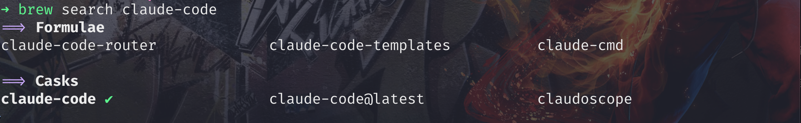

#### 2.2 方式二：npm

需要 **Node.js 22 及以上**：

```bash
npm install -g @anthropic-ai/claude-code
```

升级命令：

```bash
npm install -g @anthropic-ai/claude-code@latest
```

<div class="callout callout-warning">
<div class="callout-title"><i class="fas fa-triangle-exclamation"></i> 两个坑</div>
<div class="callout-body">

- **不要用 `sudo npm install -g`**：会有权限问题和安全风险，遇到权限报错应该修 npm 的全局目录归属。
- **别用 `npm update -g` 升级**：它遵守安装时的 semver 范围，可能升不到最新版，用上面的 `@latest` 写法。

</div>
</div>

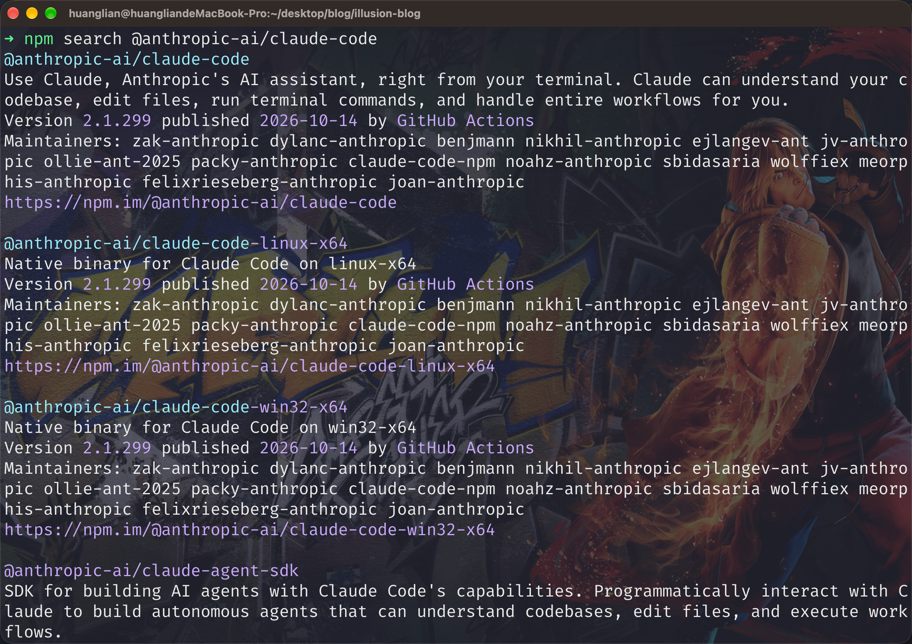

#### 2.3 验证安装

```bash
claude --version
```

能打印出版本号（如 `2.1.287 (Claude Code)`）就说明装好了。更全面的体检：

```bash
claude doctor
```

它会只读地检查安装健康度、配置文件合法性，并列出修复建议。

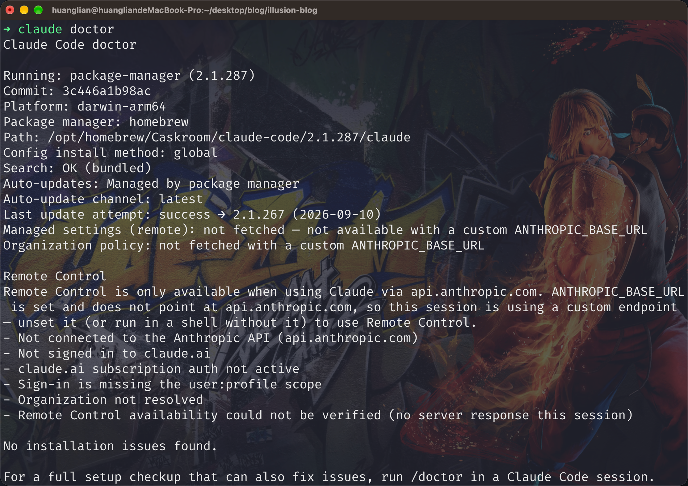

### 3. 首次启动与登录

在**项目目录**里启动（Claude Code 以当前目录作为工作区）：

```bash
cd 你的项目目录
claude
```

首次启动会依次让你：① 选主题配色 → ② 选择登录方式（跳转浏览器授权）。账号需要 **Pro / Max / Team / Enterprise 订阅**或 **Console API 账号**，免费版 claude.ai 不包含 Claude Code。

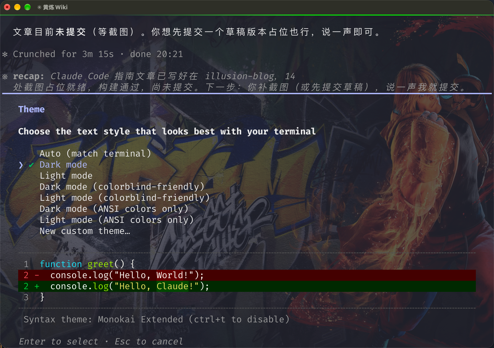

### 4. 基础配置

#### 4.1 settings.json

全局配置在 `~/.claude/settings.json`，最常用的是 `env` 段：

```json
{
  "env": {
    "ANTHROPIC_BASE_URL": "https://api.example.com",
    "ANTHROPIC_AUTH_TOKEN": "sk-xxxx（你的密钥）"
  }
}
```

配置了第三方中转/供应商地址时用这两个变量；官方订阅用户登录后不需要填。

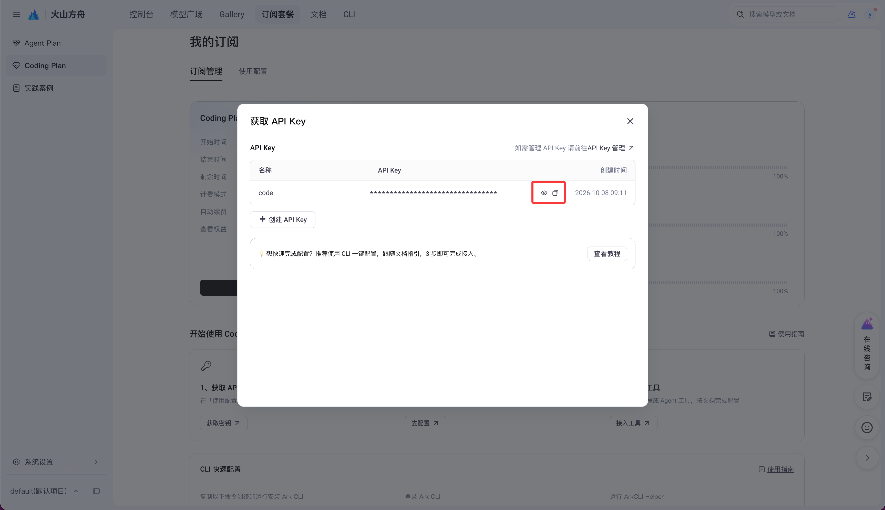

#### 4.2 CLAUDE.md：让 Claude 记住你的规矩

`CLAUDE.md` 是记忆文件，每次会话自动加载：

| 位置 | 作用范围 |
| --- | --- |
| `~/.claude/CLAUDE.md` | 全局，所有项目生效 |
| `项目根目录/CLAUDE.md` | 仅当前项目 |

内容写项目的约定：构建命令、代码风格、目录结构等。会话中输入以 `#` 开头的句子可以直接追加进记忆文件。

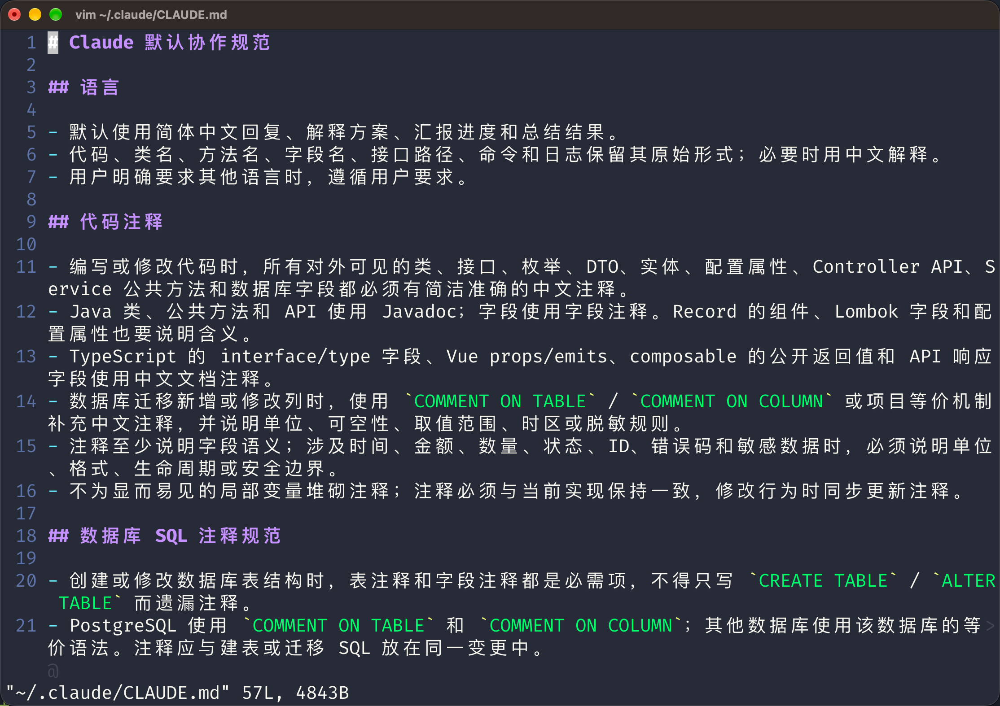

#### 4.3 权限模式：Shift + Tab

会话中按 `Shift + Tab` 在三种模式间循环切换：

| 模式 | 行为 |
| --- | --- |
| default | 每次改文件/执行命令都要你确认 |
| accept edits | 自动接受文件编辑，命令仍需确认 |
| plan mode | 只读分析，先出方案不动代码 |

计划模式适合先让 Claude 出思路，确认后再动手。

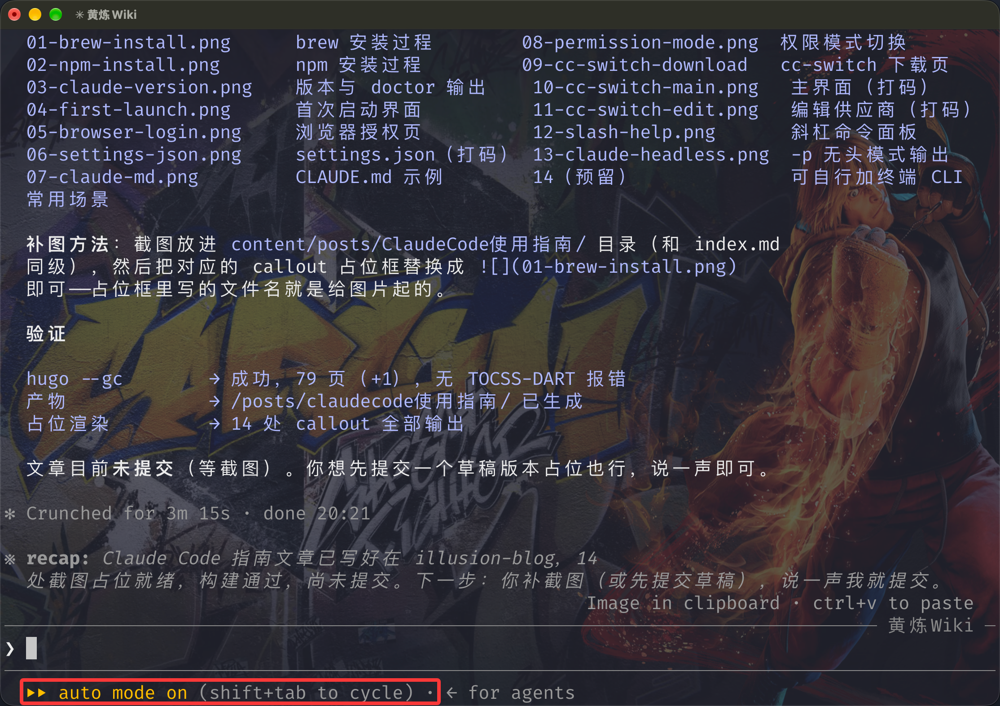

### 5. cc-switch：多供应商一键切换

#### 5.1 解决什么问题

接入第三方中转/国产模型时，切换供应商意味着手动改 `settings.json` 里的 `BASE_URL` 和 `TOKEN`——改错一个字符就半天排查。<a href="https://github.com/farion1231/cc-switch" target="_blank" rel="noopener">cc-switch</a> 是一个开源桌面应用，把这些配置做成列表，**一键切换**。

核心设计是**最小侵入**：切换时只替换连接三要素（端点、密钥、模型名），你自己配的 hooks、MCP、环境变量全部保留。首次改写配置前还会自动备份到 `~/.cc-switch/backups/`。

#### 5.2 安装

| 平台 | 方式 |
| --- | --- |
| macOS 12+ | `brew install --cask cc-switch` 或官网下载 DMG（已签名公证） |
| Windows 10+ | MSI 安装包或便携版 zip |
| Linux | deb / rpm / AppImage |

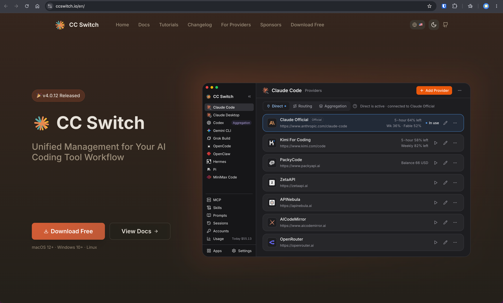

#### 5.3 添加供应商并切换

1. 首次启动会自动把现有配置导入为 `default` 供应商，不会丢配置；
2. 点「添加供应商」，填名称、`BASE_URL`、`API Key`（90+ 预设可直接选）；
3. 在列表里点目标供应商即可完成切换，**Claude Code 无需重启**，下一个会话即生效。

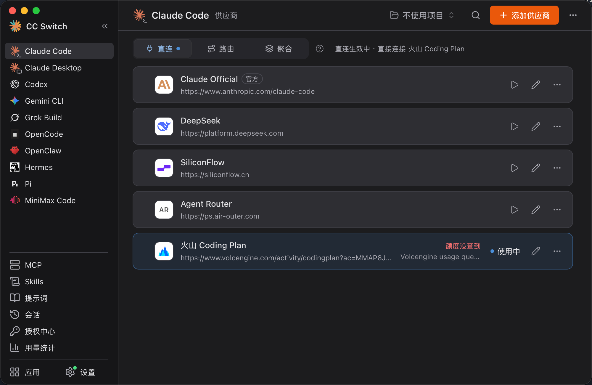

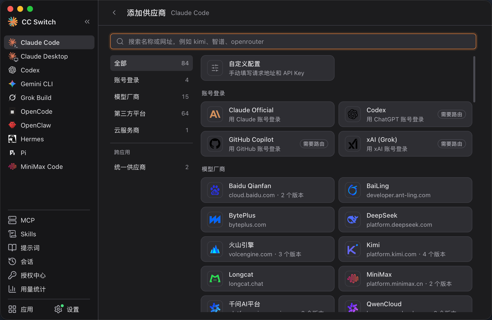

#### 5.4 三种连接模式

| 模式 | 机制 | 适合 |
| --- | --- | --- |
| Direct 直连 | 配置直接写供应商地址 | 单一供应商，最简单 |
| Routing 本地路由 | 配置指向 `127.0.0.1:15721`，由 cc-switch 转发 | 需要格式转换、自动故障转移 |
| Aggregation 聚合 | 多个供应商的模型合并进一个列表 | 同时用多家模型 |

<div class="callout callout-tip">
<div class="callout-title"><i class="fas fa-lightbulb"></i> 密钥安全</div>
<div class="callout-body">

无论截图还是写博客，**永远不要露出真实密钥**。cc-switch 的数据存在本地 `~/.cc-switch`（SQLite），云同步功能（WebDAV/S3）使用时注意保管好同步目标。

</div>
</div>

### 6. 常用命令速查

#### 6.1 会话内斜杠命令

按 `/` 呼出命令面板，常用的分三类：

**会话与上下文**

| 命令 | 作用 |
| --- | --- |
| `/clear` | 清空对话历史，重开干净上下文 |
| `/compact` | 压缩历史，释放上下文空间（长会话必备） |
| `/resume` | 恢复某次历史会话 |
| `/rewind` | 回退对话与代码（也可双击 <kbd>Esc</kbd>） |
| `/export` | 导出当前对话 |
| `/rename` | 给当前会话改名 |

**项目与记忆**

| 命令 | 作用 |
| --- | --- |
| `/init` | 扫描项目并生成 `CLAUDE.md`（新项目第一个跑的命令） |
| `/memory` | 编辑 CLAUDE.md 记忆文件 |
| `/permissions` | 管理工具权限规则 |
| `/todos` | 查看任务清单 |

**配置与诊断**

| 命令 | 作用 |
| --- | --- |
| `/config` | 设置面板（主题、更新通道等） |
| `/model` | 切换模型 |
| `/agents` | 管理子代理 |
| `/mcp` | 管理 MCP 服务器连接 |
| `/cost` / `/usage` | API 花费 / 订阅用量 |
| `/doctor` | 体检安装与配置 |
| `/login` / `/logout` | 账号登录与登出 |

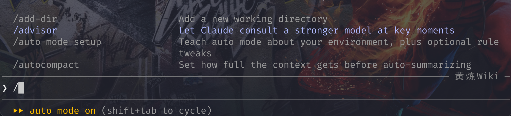

#### 6.2 终端 CLI 参数

不进交互界面也能用，方便写脚本：

| 命令 | 作用 |
| --- | --- |
| `claude` | 启动交互会话 |
| `claude "修复登录页的报错"` | 带初始提示启动 |
| `claude -p "总结这个项目的构建方式"` | 无头模式：输出结果后退出，适合脚本 |
| `claude -c` | 继续最近一次会话 |
| `claude -r` | 从列表中选择历史会话恢复 |
| `claude update` | 手动更新 |
| `claude mcp add/list` | 命令行管理 MCP 服务器 |
| `claude doctor` | 安装与配置体检 |

#### 6.3 快捷键与输入技巧

| 输入 | 作用 |
| --- | --- |
| `Shift + Tab` | 循环切换权限模式（见 4.3） |
| `Esc` | 打断当前正在执行的操作 |
| 双击 `Esc` | 打开 rewind，回退到之前的对话/代码 |
| `!` 前缀 | 不经 AI，直接执行 shell 命令（如 `! pnpm build`） |
| `@` 前缀 | 引用文件/目录（带补全），如 `@src/index.js 这个文件是干嘛的` |
| `#` 前缀 | 把一句话写进 CLAUDE.md 记忆 |
| `Ctrl + C` | 取消当前输入；连按两次退出 |

### 7. 配置文件速查

| 文件 | 作用 |
| --- | --- |
| `~/.claude/settings.json` | 用户全局配置（env、权限、模型等） |
| `项目/.claude/settings.json` | 项目配置，随 Git 共享给团队 |
| `项目/.claude/settings.local.json` | 项目个人配置，不入库 |
| `~/.claude/CLAUDE.md` | 全局记忆 |
| `项目/CLAUDE.md` | 项目记忆，`/init` 自动生成 |

### 8. 小结

一条最短路径：`brew install --cask claude-code` → 项目目录运行 `claude` → 浏览器登录 → `/init` 初始化项目 → 开工。多供应商场景再叠一个 cc-switch，从此切配置不碰 JSON。

- Claude Code 官方文档：<https://code.claude.com/docs>
- cc-switch 项目地址：<https://github.com/farion1231/cc-switch>
