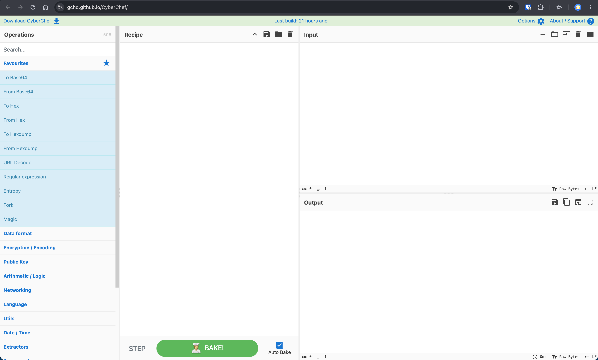
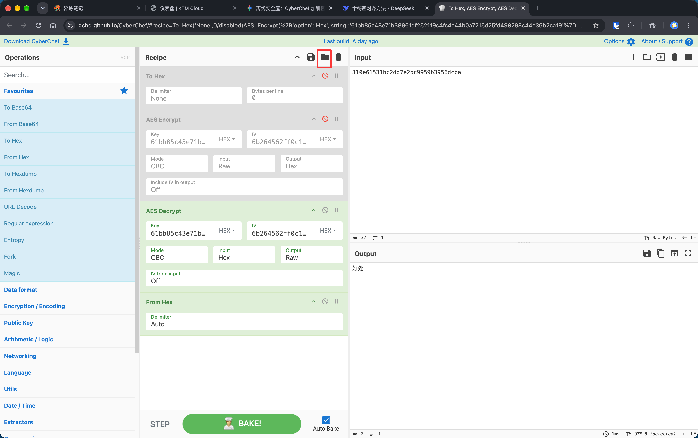

> 💡 **防追踪宣告**
>
> 为了保障我们之间敏感情报与私密对话的绝对安全，我们启用这套**不依赖任何第三方服务器、完全在本地浏览器沙盒运行**的无痕加密协议。
>
> 本协议基于国际标准 **AES-256-CBC** 算法。即便通信信道（如 Tuta 邮件）被截获，只要妥善保管离线交换的 **Key（密钥）** 与 **IV（初向量）**，任何第三方均无法还原对话原文。

## 1. 搭建离线安全屋（环境准备）

我们采用英国通信情报机构 (GCHQ) 开源的"密码学瑞士军刀" —— **CyberChef**。

🔗 **官方访问入口：** [https://gchq.github.io/CyberChef/](https://gchq.github.io/CyberChef/)

<div class="callout callout-tip">
<div class="callout-title"><i class="fas fa-shield-halved"></i> 🛡️ 极客安全建议</div>
<div class="callout-body">

CyberChef 属于纯前端应用，页面加载完成后，所有数据计算都在浏览器本地完成。
加载完成后，建议切换至【无痕模式】并【完全切断网络/断开 Wi-Fi】后使用。

</div>
</div>

### 1.1 🎛️ 界面四大核心区域



|**算子库 (Operations)**|**输入区 (Input)**|
| ---------------------------------------------------------| --------------------------------------------|
|检索、选择加解密算法与编码转换模块（如 AES、To Hex 等）|粘贴待处理的原始明文或收到的待解密密文|
|**流水线 (Recipe)** |**输出区 (Output)**|
|编排算法处理逻辑与先后顺序，可单独开关/禁用各个步骤|即时渲染最终的加密串或还原出的中文明文结果|

## 2. 配置一键加密/解密流水线

### 2.1 一键导入 Recipe JSON

请复制下方已经调校好的标准配置文件 JSON：

```JSON
[
  {
    "op": "To Hex",
    "args": [
      "None",
      0
    ],
    "disabled": true
  },
  {
    "op": "AES Encrypt",
    "args": [
      {
        "option": "Hex",
        "string": "61bb85c43e71b38961df252119c4fc4c44b0a7215d25fd498298c44e36b2ca19"
      },
      {
        "option": "Hex",
        "string": "6b264562ff0c10ef98675938cc619962"
      },
      "CBC",
      "Raw",
      "Hex",
      {
        "option": "Hex",
        "string": ""
      },
      "Off"
    ],
    "disabled": true
  },
  {
    "op": "AES Decrypt",
    "args": [
      {
        "option": "Hex",
        "string": "61bb85c43e71b38961df252119c4fc4c44b0a7215d25fd498298c44e36b2ca19"
      },
      {
        "option": "Hex",
        "string": "6b264562ff0c10ef98675938cc619962"
      },
      null,
      "CBC",
      "Hex",
      "Raw",
      {
        "option": "Hex",
        "string": ""
      },
      {
        "option": "Hex",
        "string": ""
      },
      "Off"
    ]
  },
  {
    "op": "From Hex",
    "args": [
      "Auto"
    ]
  }
]
```

#### 2.1.1 📌 导入步骤：

1. 点击中间 **Recipe** 栏顶部的 **`Load recipe`** 按钮。
2. 将 JSON 文本粘贴至弹窗输入框中，点击 **Load** 载入。



### 2.2 加解密工作流切换指南

加载成功后，Recipe 栏将呈现完整的链式流水线：

可通过点击各个模块左侧的 **"禁用/启用"图标（小开关 🚫/🟢）** 快速切换状态：

|**模式**|**1. To Hex**|**2. AES Encrypt**|**3. AES Decrypt**|**4. From Hex**|**输出结果**|
| --| ---------| ---------| ---------| ---------| --------------------|
| **🔒 发送端（一键加密）**|🟢**启用**|🟢**启用**|🚫 禁用|🚫 禁用|十六进制密文串|
| **🔓 接收端（一键解密）**|🚫 禁用|🚫 禁用|🟢**启用**|🟢**启用**|UTF-8 可读中文明文|

> ⚙️ **链路原理解释：**
>
> - **`To Hex`** / **`From Hex`**：将中文文本预先转化为标准 Hex 编码，解决多字节 UTF-8 字符在跨平台 AES 加解密时易发生的乱码与断字问题。
> - **`AES Encrypt`** / **`AES Decrypt`**：采用 AES-256-CBC 算法对十六进制流进行加解密。

## 3. 密钥生成：构建真随机 Key & IV

请勿使用任何弱口令或包含个人信息的字符串。推荐采用以下强随机数生成方式：

### 3.1 💻 方式 A：Terminal 命令行（推荐）

打开 macOS Terminal 或 Linux Bash 执行：

```Bash
# 生成 32 字节 (256-bit) 强密钥 Key
openssl rand -hex 32

# 生成 16 字节 (128-bit) 初始向量 IV
openssl rand -hex 16
```

> ⚠️ **注意：** 使用 Openssl 生成的 Hex 字符串，在 CyberChef 的 Key / IV 下拉菜单中必须选择 **`HEX`**。

### 3.2 🔑 方式 B： Vaultwarden 密码管理器

1. 进入自建 Vaultwarden / Bitwarden 的 **密码生成器**。
2. **Key 生成**：字符长度设为 `32`，勾选所有字符类型。在 CyberChef 中选择 **`UTF8`**。
3. **IV 生成**：字符长度设为 `16`，勾选所有字符类型。在 CyberChef 中选择 **`UTF8`**。

## 4. 安全铁律（绝密防线）

<div class="callout callout-danger">
<div class="callout-title"><i class="fas fa-triangle-exclamation"></i> 三条铁律</div>
<div class="callout-body">

**一、信道物理隔离**

**Key 和 IV 绝不可与密文在同一个网络信道中传输！**

正确做法：Key/IV 在线下通过面对面传输、U 盘传递，或通过独立的离线信道约定；网络信道仅用于传输密文。

**二、顺序严格对齐**

请务必遵循 `To Hex ➔ AES Encrypt ➔ AES Decrypt ➔ From Hex` 的处理顺序。直接加密未转码的中文字符串容易发生 `ACK/` 截断与破坏性乱码。

**三、一文一 IV（动态向量）**

密钥 Key 可长期保留，但 **IV（初始向量）建议每次发送加密消息时均更新一次**，以防范针对 CBC 模式的重放攻击与模式分析。

</div>
</div>
